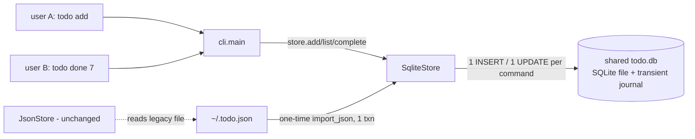

# Proposal a — Simplest design: one SQLite table behind the same three-method store

## Overview
Add a `SqliteStore` class next to `JsonStore` in `todo/storage.py`. It keeps the same `add / list / complete` interface and stores tasks in a single table in one SQLite file (stdlib `sqlite3`). SQLite handles everything the requirements ask for: each add or complete is a single-statement transaction that changes one row (O(log n), not O(n)). Its file locking serialises writers from any process or user. The journal makes commits atomic, so a crash can't leave a truncated file. `INTEGER PRIMARY KEY AUTOINCREMENT` gives unique ids that only go up. There's no lock code, log format, compaction step or daemon to write ourselves. The CLI switches its default store, and a one-shot `import_json` moves the old `~/.todo.json` data across.

## Components / modules
- `SqliteStore(path=DEFAULT_DB)` — new class in `todo/storage.py` (~45 lines). It opens the connection with `timeout=10` (busy wait) in autocommit mode and runs `CREATE TABLE IF NOT EXISTS tasks(id INTEGER PRIMARY KEY AUTOINCREMENT, title TEXT NOT NULL, done INTEGER NOT NULL DEFAULT 0, created_at TEXT NOT NULL)`. Before connecting, it creates the file with `os.open(path, O_CREAT, 0o666)` so the creator's umask applies (see Risks).
  - `add`: one `INSERT`. The id comes from `lastrowid`.
  - `complete`: `UPDATE … WHERE id=?`. If `rowcount == 0` it raises `KeyError`, then it `SELECT`s the row. (No `RETURNING`, so SQLite older than 3.35, which some Python 3.10 builds bundle, still works.)
  - `list`: `SELECT … [WHERE done=0] ORDER BY id`.
  - `import_json(json_path)`: inserts every task with its original id inside one `BEGIN IMMEDIATE … COMMIT`.
- `DEFAULT_DB` — new constant: `os.environ.get("TODO_DB", "~/.todo.db")` (expanded). For a shared list, every user sets `TODO_DB` to the same path.
- `JsonStore` — reused and unchanged (`todo/storage.py`). It stays as the migration source, and the existing tests keep using it.
- `todo/cli.py` — changed, about 3 lines. The default becomes `SqliteStore()`. On first run, if the DB file doesn't exist and `~/.todo.json` does, the CLI imports it and renames the JSON file to `~/.todo.json.migrated`. The `main(argv, store=None)` injection point and all output stay the same.
- `Task` model — reused and unchanged (`todo/models.py`). Rows map 1:1 to its fields.
- `tests/test_sqlite_store.py` — new. It runs the same five cases against `SqliteStore`, plus an import test and a multiprocess concurrency test.

## Diagram

## Data flow
1. `todo add X`: the CLI connects, runs one `INSERT` (autocommit, so it's an implicit transaction), and prints `added {id}: X`.
2. `todo done N`: one `UPDATE`. If no row matched, it raises `KeyError` (same as today).
3. `todo list`: one `SELECT`, which builds `Task` objects.
4. Concurrency: SQLite's POSIX file locks admit one writer at a time. Other writers wait up to the busy timeout (10 s) and then go ahead. Readers see only committed data.

## Fit with existing code
The interface is identical, so `main(store=...)` injection keeps working. The existing `tests/test_storage.py` runs unchanged (5/5), and the same file run against `SqliteStore` also passes 5/5. The design adds one class, one constant and a few CLI lines, and introduces only one new concept: an SQL table. Adding future fields (due dates, tags) means `ALTER TABLE ADD COLUMN` plus a dataclass field. Tags could get a second table later if they're actually needed.

## Migration path
1. Add `SqliteStore` and its tests. `JsonStore` stays the default, so nothing changes for users yet.
2. Switch the CLI default and add the automatic first-run import. This step is reversible: the JSON file is renamed, not deleted, and `import_json` runs in one transaction, so it either fully happens or doesn't happen at all.
3. Shared setup, documented in the README:
   - Create the shared directory: `install -d -m 2775 -g todo /srv/todo`.
   - Each user sets `TODO_DB=/srv/todo/todo.db`.
   - The first user imports their list there (ids preserved).
   - A second user with their own legacy file imports into the shared DB. If any ids clash, `import_json` fails as a whole and loses nothing. Merging with renumbered ids could be added only if someone needs it (YAGNI).

## Requirements check
- **H1 stdlib only: met.** Uses `sqlite3`, `os` and `json` only.
- **H2 no lost updates or corruption: met by mechanism.** Writes are serialised by SQLite's locks, commits are atomic through the journal, and ids come from AUTOINCREMENT. The concurrency spike (16 processes as 2 OS users) and the SIGKILL spike below demonstrate it.
- **H3 lossless migration: met.** A 50k-task JSON file round-trips field-for-field equal, in one transaction, and the source file is kept.
- **H4 no daemon: met.** SQLite is a library linked into the CLI process.
- **S1:** works on Linux and macOS, and Windows also works with sqlite. **S2:** partly met. The store is binary, but `sqlite3 todo.db 'select * from tasks'` and `todo list --all` make it inspectable.
- **Correctness under concurrency (25):** strong. Correctness comes from a mature engine's locking and journal and is shown by spikes. There's no custom locking code.
- **Performance at 50k (20):** add takes about 2.1 ms and complete about 2.3 ms with a fresh connection per operation (≪100 ms). A whole `todo add` process takes 58 ms, against 435 ms today, and most of that 58 ms is interpreter start-up.
- **Simplicity (20):** about 50 new lines, one class, no lock, log or compaction code.
- **Migration risk (20):** an additive class, an atomic import, the legacy file kept, and the old tests untouched.
- **Fit / extensibility (15):** same interface, and new fields are added as columns.

## Evidence vs. assumptions
All spikes are in `wt-a/.spike/`, using a prototype of `SqliteStore` (`sqlite_store.py`).
- **EVIDENCE:** add and complete are independent of task count. `python3 .spike/bench.py` at 50k rows gives: add median 2.05 ms (max 2.8), complete median 2.30 ms (max 6.0), new connection each time. The full CLI `add` process takes 58 ms, against 435 ms for JsonStore.
- **EVIDENCE:** list is not slower than today. `python3 .spike/listbench.py` (warm, median of 7) gives:

  | Store | `include_done=False` | `include_done=True` |
  |---|---|---|
  | JsonStore (today) | 84 ms | 92 ms |
  | SqliteStore | 52 ms | 66 ms |

  One cold first run measured 121 ms against 93 ms.
- **EVIDENCE:** migration is lossless and fast. In `bench.py`, a 50,001-task import took 176 ms, and `before == after` (id, title, done and created_at all equal).
- **EVIDENCE:** no lost updates and no duplicate ids across processes and OS users. `python3 .spike/concurrency.py` ran 16 processes alternating uid 1001 and 1002 (shared gid, setgid dir), each doing 300 adds plus 100 completes, with a new connection per operation. Result: 4800 of 4800 tasks, 4800 unique ids exactly 1..4800, 1600 of 1600 done, `integrity_check` ok.
- **EVIDENCE:** today's store really does lose writes (negative control). `.spike/control_and_kill.py` ran JsonStore with 8 writers × 100 adds and kept only **92 of 800**.
- **EVIDENCE:** no torn state after a crash. Same script: SIGKILL during a 50k-row import transaction, repeated 10 times, always left either 0 or 50,000 rows and never a partial count. `integrity_check` was ok every time.
- **EVIDENCE (disproved my first assumption):** SQLite creates new DB files as 0644 *regardless of umask*. In the first multi-user run, 8 of 16 workers failed with `attempt to write a readonly database` and 2400 of 4800 rows were lost. Fix: pre-create the file with `os.open(..., 0o666)` so umask applies. The rerun gave the file mode `-rw-rw-r--` and all 4800 rows. The transient journal inherits the DB file's mode, so the second uid could write through it.
- **ASSUMPTION:** SQLite's POSIX locks are reliable on the shared path. That holds on a local filesystem, but it breaks on NFS and similar network filesystems. It's untested because "same machine" implies a local disk. Testing it would mean running `concurrency.py` on the target mount.
- **ASSUMPTION:** a 10 s busy timeout is enough. At CLI rates, writes hold the lock for about 2 ms. To test it, measure the worst-case wait under the concurrency spike.

## Risks and trade-offs
- **Shared-permission setup is a manual step.** It needs a group-writable setgid directory, and the file must be group-writable. The first creator needs umask 002, or a one-off `chmod g+w`. Without this, other users fail loudly with "readonly database", but no data is lost. The README must document it.
- **Not plain-text human-readable (S2).** This is the main trade-off of picking a mature engine over a hand-rolled JSONL log plus `fcntl` locking, which is readable but needs custom lock, id and compaction code.
- **Unsafe on network filesystems.** No WAL is used on purpose: the default rollback journal leaves no persistent `-wal`/`-shm` files to manage permissions for. The cost is that a long `list` briefly blocks writers, which is acceptable at CLI scale.

## Effort
About half a day: roughly 50 lines of code, about 60 lines of tests, and a README section on the shared setup.

## Confidence: 8/10
