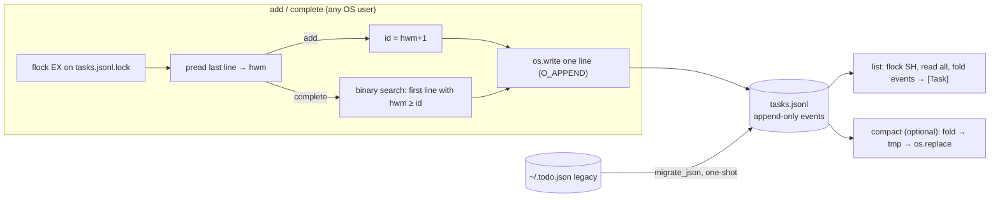

# Proposal c — Different in kind: an append-only event log (JSON Lines) instead of a mutable store

## Overview
**The obvious design** is to replace the JSON file with a mutable table: SQLite (`UPDATE tasks SET done=1 WHERE id=?`), or the same JSON file guarded by `flock` plus atomic rename. Both keep "the file is the current state" and edit that state in place.

**This design keeps history instead of current state.** The store is a JSON Lines file (`tasks.jsonl`), and each line is an immutable *event*:
```
{"op":"add","id":7,"title":"buy milk","done":false,"created_at":"…","hwm":7}
{"op":"done","id":7,"hwm":7}
```
Current state is a *fold* over the events. Because nothing is rewritten, `add` and `complete` each become one `write()` of under 200 bytes onto an `O_APPEND` fd, done while holding an exclusive `flock`. That makes the cost O(1) in the number of tasks. Two invariants carry the rest of the design:
- **`hwm`** ("high-water mark", the highest id issued so far) is on every line. The next id is `hwm+1`, read from the **last line only**, so finding it stays O(1) however many `done` events are in the log.
- `hwm` never decreases from one line to the next and only goes up on `add` lines. So `complete(id)` **binary-searches the file by byte offset** for the first line with `hwm >= id`, and that line is the task's `add` record. This costs O(log n) `pread`s and needs no index file. It keeps today's `KeyError` and the returned `Task` with its title.

`list` replays the log in O(n), which P2 allows. An optional `compact()` folds the log back to one line per task. Everything uses the stdlib modules `json`, `os` and `fcntl`.

## Components / modules
- `todo/storage.py::LogStore` — **new**, about 120 lines. It holds `add` / `list` / `complete` / `compact` plus the helpers `_tail`, `_find_add` and `_fold`. `JsonStore = LogStore` is kept as an alias so `cli.py` and the tests still import the same name.
- `todo/storage.py::migrate_json(json_path, log_path)` — **new**, about 15 lines. It writes one `add` line per legacy task and **leaves `~/.todo.json` untouched**.
- `todo/storage.py::LegacyJsonStore` — **reused**: today's `JsonStore` code, renamed. It is the reader for migration and the rollback path.
- `todo/models.py::Task` — **reused unchanged**. Events are `{"op":…, **task.to_dict(), "hwm":…}`, so new dataclass fields (due, tags) flow through automatically.
- `todo/cli.py` — **one-line change**. The default path comes from `$TODO_FILE`, falling back to `~/.todo.jsonl`. An optional `todo compact` subcommand can be added.
- Lock file `<log>.lock` — **new**, a sidecar that is never replaced. Writers take `LOCK_EX`; `list` takes `LOCK_SH`.

## Diagram


## Data flow
- **add:** open and `flock(EX)` the sidecar lock, then open the log with `O_APPEND`. `pread` the last 4 KiB to get `hwm`. If the file does not end in `\n`, a writer crashed mid-line; we hold the exclusive lock, so we `ftruncate` the torn tail. Then write one line and close, which releases the lock. Optionally `fsync` if `TODO_FSYNC` is set.
- **complete(id):** take the lock and read `hwm` the same way. If `id` is outside `1..hwm`, raise `KeyError`. Otherwise binary-search for the add record, append `{"op":"done",…}`, and return `Task(done=True)`.
- **list:** take `flock(SH)` and read the whole file. Parse it in one `json.loads` call by joining the lines into an array, which is much faster than parsing line by line. Then fold, so `done` events override `add`, and build the `Task` list.
- **compact:** under `EX`, fold the events, write a tmp file, `fsync` it, `chmod 0666` and `os.replace` it over the log. Writers open the data file **after** they take the sidecar lock, so no writer can append to a replaced inode. The race spike runs a concurrent compactor to check this.

## Fit with existing code
- The interface is unchanged: `add`, `list`, `complete` and `main(store=…)`. All 5 existing tests pass **unmodified** against the spike store when the `JsonStore` name is pointed at it (`.spike/test_logstore.py` is `tests/test_storage.py` with only the import line rewritten).
- The store is still plain JSON a human can read (S2), and it is easier to audit than before: `grep '"id":7,' tasks.jsonl` shows a task's full history. Adding a new operation such as `retitle`, `untag` or `reopen` means adding one event type and one branch in `_fold`; the format needs no schema migration.

## Migration path
1. Ship `LogStore`, `migrate_json` and `LegacyJsonStore` alongside the current code, and put the existing tests on a parametrized fixture that runs both stores.
2. On first run, if `~/.todo.json` exists and the log does not, `migrate_json` runs under the lock. It writes the log to a tmp file, fsyncs it and renames it into place. The legacy file is **kept**, so rolling back means deleting `tasks.jsonl`. The spike migrated a 50k-task file in about 400 ms and the roundtrip was identical: `[t.to_dict() for t in LogStore.list(True)] == json.load(old)`.
3. For sharing: `install -d -m 2775 -g todo /srv/todo`, then each user sets `TODO_FILE=/srv/todo/tasks.jsonl`. Files are created `0666 & ~umask`, and compaction `chmod`s the result to `0666`. Use a setgid group directory rather than sticky `/tmp`: with `fs.protected_regular>=1` (default on many distros), opening another user's file with `O_CREAT` is refused in sticky world-writable directories.

## Requirements check
- **H1 stdlib only — met.** Uses only `json`, `os` and `fcntl`.
- **H2 no lost updates or corruption — met by mechanism.** Every read-modify-append runs under an exclusive `flock` that the kernel releases automatically if the process dies. Appends never touch existing bytes. A torn final line, left only when a writer crashes, is ignored by readers and truncated by the next writer. Compaction uses tmp + `os.replace`, and the stable sidecar lock rules out the stale-inode race. The race spike exercised all of this with 4 distinct uids and a concurrent compactor.
- **H3 migration without loss — met.** The migration is a 1:1 line conversion with a verified roundtrip, and the source file is kept.
- **H4 no daemon — met.** Each command opens the file, locks, works and exits.
- *Correctness under concurrency (25):* strong. The guarantee comes from the lock and an immutable log, the spike shows it, and the negative control on today's store corrupted the file.
- *Performance at 50k (20):* excellent. add 0.02 ms and complete 0.1 ms median, independent of n, measured against about 310 ms per operation today. `list` is close to parity on a compacted log (about 84 ms vs 70–82 ms) and about 100–117 ms with 20k extra done events. That last figure is slightly slower than today, which P2 does not allow, unless the log is compacted.
- *Simplicity (20):* moderate. The `hwm` binary search and torn-tail handling are new ideas for a newcomer, though each is about 15 lines; SQLite would hide them.
- *Migration risk (20):* low. The legacy file is never modified, rollback is deleting one file, and the tests carry over unchanged.
- *Fit / extensibility (15):* good. The interface is unchanged, `Task` fields pass through, and new operations are new event types.

## Evidence vs. assumptions
All spike code is in `wt-c/.spike/` (`logstore.py`, 164 lines).
- **EVIDENCE:** the existing tests pass. `python3 -m pytest -q .spike/test_logstore.py` → `5 passed`.
- **EVIDENCE:** 50k-task performance. `python3 .spike/bench.py` → legacy add 312 ms and complete 331 ms. The log store gives add 0.02 ms, complete 0.09–0.11 ms (median; max 0.29 ms) for random ids, the first id and the last id. After 20k more done events: add 0.03 ms, complete 0.11 ms. With `TODO_FSYNC=1`: add 0.25 ms, complete 0.44 ms.
- **EVIDENCE:** migration is lossless. Same bench → `migrate 406 ms`, `migration roundtrip identical: OK`, and a missing id raises `KeyError`.
- **EVIDENCE:** `list` cost. `python3 .spike/bench_list.py` (compacted 50k log) → include_done=False 84.0 ms (legacy 82.1); include_done=True 84.1 ms (legacy 69.6). With 20k extra done events it was 100–117 ms.
- **EVIDENCE:** concurrency across uids. `python3 .spike/race.py` runs 8 forked writers as uids 65534, 1000, 1001 and 1002 (300 adds each, plus a complete every third add, about 600 in all) alongside a compactor making 40 passes. On every run: 2400/2400 tasks, ids unique and contiguous 1..2400, every id returned to a caller is present, and every completed id reads done. The test was run 4 times with the same result.
- **EVIDENCE:** negative control. `python3 .spike/race.py legacy` (today's `JsonStore`) → 8/8 writers crashed with `JSONDecodeError` and the final file was corrupt ("Extra data").
- **EVIDENCE:** crash recovery. A torn half-line was appended by hand. `list` ignored it, the next `add` got id 3, and the writer truncated the garbage. An earlier version that only fenced the torn line was **disproved**: the bulk parse then failed. That is why the design truncates under the lock.
- **EVIDENCE:** binary-search correctness. An exhaustive check over 300 tasks with about 350 interleaved done events → `all 300 found: True`. An earlier version that searched for add lines by scanning showed a 53 ms worst case when the search landed in a long run of done lines. The `hwm` invariant removed that case.
- **ASSUMPTION:** `flock` behaves the same on macOS. It is BSD-native, so this is likely, but untested here; running `race.py` on a Mac would settle it. On NFS, `flock` is unreliable, and the user would need a local filesystem (true of SQLite too).
- **ASSUMPTION:** Windows needs an `msvcrt.locking` shim (S1 marks Windows as nice-to-have), and `O_APPEND` semantics there are weaker. Untested.

## Risks and trade-offs
- **The log grows.** Every `complete` adds about 30 bytes. `list` stays near today's cost only if the log is compacted now and then. Mitigation: auto-compact when the line count exceeds 1.5× the task count (checked cheaply during `list`), or run `todo compact` from cron. Compaction is O(n), but it is rare and runs under the lock.
- **Custom concurrency code.** We maintain our own locking, truncation and tail-read logic (about 40 subtle lines) instead of relying on SQLite's tested engine. The spike covers the main paths but not power loss on every filesystem; `TODO_FSYNC` is opt-in.
- **Non-sequential access gets harder.** Future queries such as filtering by tag or due date would be O(n) scans. That is fine at 50k (about 100 ms), but SQLite would win if querying becomes a feature.
- **Hand edits can break the invariant.** A user who hand-edits the log could break `hwm` monotonicity. A one-line `fsck` in `_fold` can detect that.

## Effort
About half a day. That covers about 120 lines in `storage.py`, a few lines in `cli.py` for the path, `todo compact` and `$TODO_FILE`, tests parametrized over both stores, and the race test turned into a pytest using `multiprocessing`. The multi-uid part is skipped unless the tests run as root.

## Confidence: 7/10
The mechanism and the numbers are demonstrated, not argued. Points come off for the hand-rolled concurrency and recovery code (SQLite gives those for free), `list` falling slightly behind today until the log is compacted, and macOS and Windows locking being untested.
